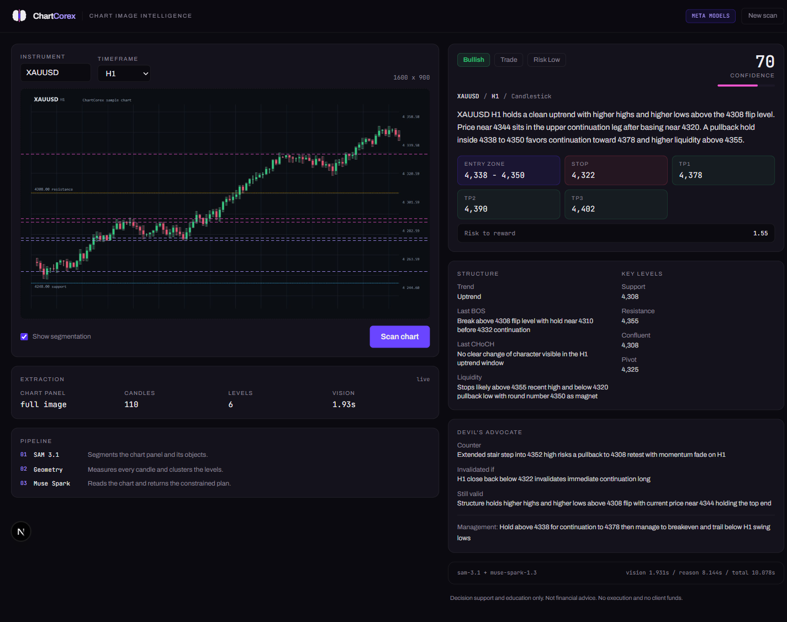

# ChartCorex

Chart image intelligence on the Meta Model API. Upload a chart screenshot and receive a complete trade structure: entry zone, stop loss, three take profits, confidence, market structure and reasoning.

Decision support and education only. No execution, no client funds, no signal group.

This build uses Meta models exclusively: `sam-3.1` and `muse-spark-1.3` through the Meta Model API. There is no model-provider SDK in the project; the app calls the endpoint directly with `fetch`, so the only model dependency is Meta's own API.



## How it works

1. `sam-3.1` segments the chart panel over `/v1/responses` with a concept prompt, returning boxes and masks in source pixels.
2. `src/lib/vision/candles.ts` decodes the image with sharp and recovers every candle deterministically: hue classification for bullish and bearish bodies, vertical run filtering, then body and wick extents per column group.
3. `src/lib/vision/geometry.ts` derives swing highs and lows, clusters support and resistance, fits the visible trend and normalises everything to image space.
4. `muse-spark-1.3` reads the image together with that measured geometry and returns schema-constrained JSON, so the plan always matches the contract in `src/lib/schema/plan.ts`.

Reasoning runs at `reasoning.effort: "low"` with an 8000 token output budget. A measured scan on a 1600x900 chart takes about 13 seconds: 2 to 3 seconds of segmentation, under a second of extraction, and 9 to 11 seconds of reasoning.

The prompt layer in `src/lib/prompts/` is an institutional rule set written for image-first analysis. Only visible evidence scores; every absent panel contributes zero.

## Brand

The mark is a 3D render of two brain hemispheres, navy on the left and pink on the right, with a teal candle between them. The candle is centred on the brain, with equal overhang above and below, and stands taller than the brain. The wordmark sets Chart in violet #105BFF and Corex in pink #F355D0, set in Comfortaa. It is used for the header, the favicon and the app icon.

The landing hero is a real screen recording of the app: image upload, scan, report. `scripts/record-demo.mjs` records it with Playwright and the result is encoded into `public/media/demo.mp4`.

Palette: violet and pink lead. Navy `#070B10` and `#0D141C` surfaces, violet `#105BFF` and pink `#F355D0` for the wordmark and brand accents, and teal `#81FFD9` reserved for primary buttons, with black text, plus small interface accents. Green and red are reserved exclusively for price direction. Buttons are rectangular with a 12px radius. UI type is Comfortaa, which also sets the wordmark, with the heavier rounded system display stack for headings, menu items and buttons. Dark is the default theme, with light available from the header toggle.

Every result shows the Meta response IDs for the segmentation and the reasoning calls, so API usage is verifiable in the product, not only in the code.

## What is measured and what is reasoned

- Candle highs, lows, bodies, swing points and clustered levels are **measured** from pixels, not guessed by a model.
- The chart panel region is **segmented** by SAM 3.1.
- Trend interpretation, market structure, level significance and the trade plan are **reasoned** by Muse Spark, with the geometry as corroboration.

SAM 3.1 does not recognise individual candlesticks as a concept (tested: it returns zero matches for "candlestick" and "candle"). It does segment the chart panel reliably. That is why the candle layer is deterministic pixel analysis rather than segmentation. Do not claim otherwise in any submission copy.

## Run locally

```powershell
Copy-Item .env.local.example .env.local
# add MODEL_API_KEY
npm run dev
```

Open http://localhost:3000 for the landing page, and http://localhost:3000/scan for the workbench.

Without `MODEL_API_KEY` the app runs in mock mode so the interface can be exercised. The UI shows a `mock data` badge whenever that happens.

## API

`POST /api/analyze`

```json
{
  "imageBase64": "<base64 without data prefix>",
  "mimeType": "image/jpeg",
  "imageWidth": 1600,
  "imageHeight": 900,
  "instrument": "XAUUSD",
  "timeframe": "H1"
}
```

Returns the plan, the segmentation result, the derived geometry, per-stage timings and the model IDs used.

## Deployment

- GitHub: https://github.com/shyampitamber/ChartCorex (public, shared with Meta for judging)
- Production: https://chartcorex.vercel.app
- Supabase: project ref `zdrkmddaytryrduqqxqm`, Central EU (Frankfurt)
- Vercel environment: `MODEL_API_KEY` (sensitive), `NEXT_PUBLIC_SUPABASE_URL`, `NEXT_PUBLIC_SUPABASE_ANON_KEY`, `SUPABASE_SERVICE_ROLE_KEY` (sensitive)
- Pushes to `main` deploy automatically through the Vercel Git integration

## Limits

- Works on candlestick charts with distinguishable bullish and bearish bodies. Line charts and exotic palettes may extract nothing, and the plan then falls back to the image alone.
- Images are compressed client side to a 1700px longest edge before upload.
- `maxDuration` is 60s, and a typical scan is well inside it.
- Structured output is enforced by the schema in `src/lib/schema/plan.ts`, not by post-processing.
- No em dashes in user-facing copy.
